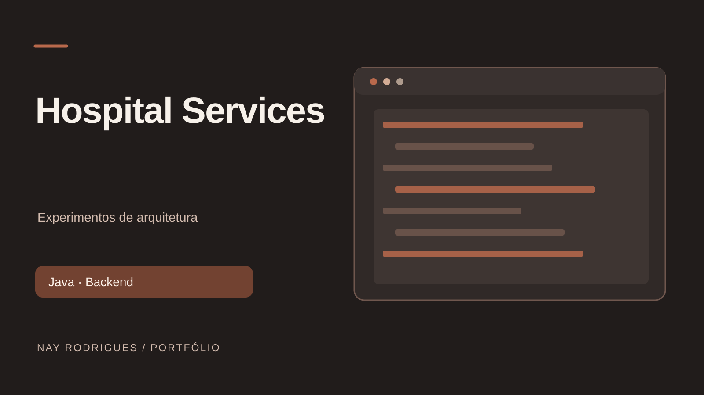

<div align="center">



# Hospital Services

Versão de estudos de arquitetura e serviços para uma aplicação hospitalar

**Projeto de estudo**

</div>


Sistema completo de gerenciamento hospitalar baseado em arquitetura de microsserviços, desenvolvido com Java 21 e Spring Boot.

## 📋 Índice

- [Sobre o Projeto](#sobre-o-projeto)
- [Tecnologias](#tecnologias)
- [Arquitetura](#arquitetura)
- [Pré-requisitos](#pré-requisitos)
- [Instalação](#instalação)
- [Execução](#execução)
- [Documentação da API](#documentação-da-api)
- [Testes](#testes)
- [Estrutura do Projeto](#estrutura-do-projeto)

## 🎯 Sobre o Projeto

Este sistema permite o gerenciamento completo de um hospital, incluindo:

- ✅ Agendamento de consultas médicas
- ✅ Agendamento de exames
- ✅ Gerenciamento de clínica e médicos
- ✅ Controle de centro cirúrgico e procedimentos
- ✅ Autenticação e autorização com roles (USUARIO, MEDICO, ADMIN)
- ✅ Comunicação assíncrona entre serviços via RabbitMQ
- ✅ API Gateway para roteamento centralizado
- ✅ Documentação interativa com Swagger

## 🛠️ Tecnologias

- **Java 21**
- **Spring Boot 3.2.1**
- **Spring Security** (OAuth2 + JWT)
- **Spring Data JPA**
- **MySQL 8.0**
- **RabbitMQ** (Mensageria)
- **Keycloak 23.0** (Autenticação)
- **Swagger/OpenAPI** (Documentação)
- **Docker & Docker Compose**
- **Maven**

## 🏗️ Arquitetura

O sistema é composto por 4 microsserviços independentes:

### 1. Serviço de Agendamento (Porta 8081)
- Cadastro de consultas e exames
- Validação de conflitos de horários
- Gerenciamento de pacientes

### 2. Serviço de Clínica (Porta 8082)
- Atendimento de consultas
- Gerenciamento de médicos
- Diagnóstico baseado em sintomas
- Solicitação de exames de alta complexidade

### 3. Serviço de Centro Cirúrgico (Porta 8083)
- Gerenciamento de procedimentos
- Exames de alta complexidade
- Suporte a procedimentos emergenciais

### 4. API Gateway (Porta 8080)
- Ponto de entrada único
- Roteamento de requisições
- Autenticação centralizada

## 📦 Pré-requisitos

Antes de começar, você precisa ter instalado:

- **Java 21**: [Download](https://www.oracle.com/java/technologies/downloads/)
- **Maven 3.8+**: [Download](https://maven.apache.org/download.cgi)
- **Docker**: [Download](https://www.docker.com/get-started)
- **Docker Compose**: [Download](https://docs.docker.com/compose/install/)

## 🚀 Instalação

### 1. Clone o repositório

```bash
git clone <url-do-repositorio>
cd hospital-microservices
```

### 2. Suba a infraestrutura com Docker

```bash
docker-compose up -d
```

Isso irá subir:
- 3 instâncias MySQL (uma para cada serviço)
- RabbitMQ
- Keycloak
- MySQL para Keycloak

### 3. Verifique se os containers estão rodando

```bash
docker ps
```

Você deve ver 6 containers rodando.

### 4. Configure o Keycloak

Acesse http://localhost:8090 e faça login com:
- **Username**: admin
- **Password**: admin

#### Criar Realm

1. Clique em "Create Realm"
2. Nome: `hospital`
3. Clique em "Create"

#### Criar Roles

1. Vá em "Realm roles" → "Create role"
2. Crie as seguintes roles:
   - `USUARIO`
   - `MEDICO`
   - `ADMIN`

#### Criar Client para cada serviço

1. Vá em "Clients" → "Create client"
2. Client ID: `agendamento-service`
3. Client authentication: ON
4. Salve e anote o Client Secret na aba "Credentials"

Repita para:
- `clinica-service`
- `centro-cirurgico-service`
- `gateway-service`

#### Criar Usuários de Teste

1. Vá em "Users" → "Add user"
2. Username: `paciente1`
3. Clique em "Create"
4. Vá na aba "Credentials" → "Set password" → Senha: `senha123`
5. Vá na aba "Role mapping" → "Assign role" → Selecione `USUARIO`

Repita para:
- `medico1` com role `MEDICO`
- `admin1` com role `ADMIN`

## ▶️ Execução

### Executar cada serviço

Abra 4 terminais diferentes e execute:

**Terminal 1 - Serviço de Agendamento:**
```bash
cd agendamento-service
mvn clean install
mvn spring-boot:run
```

**Terminal 2 - Serviço de Clínica:**
```bash
cd clinica-service
mvn clean install
mvn spring-boot:run
```

**Terminal 3 - Centro Cirúrgico:**
```bash
cd centro-cirurgico-service
mvn clean install
mvn spring-boot:run
```

**Terminal 4 - API Gateway:**
```bash
cd gateway-service
mvn clean install
mvn spring-boot:run
```

### Verificar se os serviços estão rodando

- Agendamento: http://localhost:8081/swagger-ui.html
- Clínica: http://localhost:8082/swagger-ui.html
- Centro Cirúrgico: http://localhost:8083/swagger-ui.html
- Gateway: http://localhost:8080
- RabbitMQ: http://localhost:15672 (guest/guest)
- Keycloak: http://localhost:8090

## 📚 Documentação da API

Cada serviço possui documentação Swagger interativa:

- **Agendamento**: http://localhost:8081/swagger-ui.html
- **Clínica**: http://localhost:8082/swagger-ui.html
- **Centro Cirúrgico**: http://localhost:8083/swagger-ui.html

### Principais Endpoints

#### Serviço de Agendamento

```
POST   /api/cadastro/consulta          # Cadastrar consulta
POST   /api/cadastro/exame             # Cadastrar exame
GET    /api/pesquisa/consultas/cpf/{cpf}  # Buscar consultas
GET    /api/pesquisa/exames/cpf/{cpf}     # Buscar exames
DELETE /api/admin/consultas/{id}       # Cancelar consulta (ADMIN)
DELETE /api/admin/exames/{id}          # Cancelar exame (ADMIN)
```

#### Serviço de Clínica

```
POST   /api/clinica/AtenderConsulta    # Atender consulta
POST   /api/clinica/verificar-disponibilidade  # Verificar disponibilidade
GET    /api/clinica/medicos            # Listar médicos
POST   /api/admin/medicos              # Cadastrar médico (ADMIN)
```

#### Serviço de Centro Cirúrgico

```
POST   /api/procedimentos/marcar       # Marcar procedimento
POST   /api/procedimentos/verificar-disponibilidade  # Verificar disponibilidade
GET    /api/procedimentos              # Listar procedimentos
POST   /api/admin/procedimentos        # Criar procedimento (MEDICO/ADMIN)
```

## 🧪 Testes

### 1. Obter Token JWT

```bash
curl -X POST http://localhost:8090/realms/hospital/protocol/openid-connect/token \
  -H "Content-Type: application/x-www-form-urlencoded" \
  -d "username=paciente1" \
  -d "password=senha123" \
  -d "grant_type=password" \
  -d "client_id=agendamento-service" \
  -d "client_secret={SEU_CLIENT_SECRET}"
```

Copie o valor de `access_token` da resposta.

### 2. Cadastrar uma Consulta

```bash
curl -X POST http://localhost:8081/api/cadastro/consulta \
  -H "Authorization: Bearer {SEU_TOKEN}" \
  -H "Content-Type: application/json" \
  -d '{
    "Paciente": {
      "Nome": "João Silva",
      "CPF": "123.456.789-00",
      "idade": 35,
      "Sexo": "Masculino"
    },
    "Horario": "20/12/2024 14:00",
    "Medico": "Cardiologista"
  }'
```

### 3. Cadastrar um Exame

```bash
curl -X POST http://localhost:8081/api/cadastro/exame \
  -H "Authorization: Bearer {SEU_TOKEN}" \
  -H "Content-Type: application/json" \
  -d '{
    "Paciente": {
      "Nome": "Maria Santos",
      "CPF": "987.654.321-00",
      "idade": 28,
      "Sexo": "Feminino"
    },
    "Horario": "21/12/2024 09:00",
    "Exame": "Coleta de sangue"
  }'
```

### 4. Buscar Consultas por CPF

```bash
curl -X GET "http://localhost:8081/api/pesquisa/consultas/cpf/123.456.789-00" \
  -H "Authorization: Bearer {SEU_TOKEN}"
```

## 📁 Estrutura do Projeto

```
hospital-microservices/
├── agendamento-service/       # Serviço de Agendamento
│   ├── src/main/java/...
│   └── pom.xml
├── clinica-service/           # Serviço de Clínica
│   ├── src/main/java/...
│   └── pom.xml
├── centro-cirurgico-service/  # Serviço de Centro Cirúrgico
│   ├── src/main/java/...
│   └── pom.xml
├── gateway-service/           # API Gateway
│   ├── src/main/java/...
│   └── pom.xml
├── docker-compose.yml         # Infraestrutura Docker
└── docs/                      # Documentação
    └── DOCUMENTACAO_COMPLETA.docx
```

## 🔐 Roles e Permissões

### USUARIO
- Pode cadastrar e pesquisar apenas suas próprias consultas e exames (por CPF)

### MEDICO
- Pode criar exames de alta complexidade
- Pode acessar consultas associadas a ele
- Pode visualizar todos os pacientes

### ADMIN
- Acesso total a todos os recursos
- Pode criar, editar, deletar e modificar qualquer registro
- Pode cancelar consultas e exames

## 🐛 Troubleshooting

### Problema: Serviços não iniciam

**Solução**: Verifique se as portas 8081, 8082, 8083, 8080 e 8090 estão livres.

```bash
# Linux/Mac
lsof -i :8081

# Windows
netstat -ano | findstr :8081
```

### Problema: Erro 401 Unauthorized

**Solução**: Verifique se o token JWT está válido e não expirou. Tokens expiram em 5 minutos por padrão.

### Problema: Banco de dados não conecta

**Solução**: Verifique se o Docker Compose está rodando corretamente:

```bash
docker-compose ps
docker-compose logs mysql-agendamento
```

### Problema: RabbitMQ não se conecta

**Solução**: Verifique os logs do RabbitMQ:

```bash
docker-compose logs rabbitmq
```

## 📝 Notas Importantes

- Todos os horários devem estar no formato: `dd/MM/yyyy HH:mm`
- CPFs devem estar no formato: `XXX.XXX.XXX-XX`
- Tokens JWT expiram em 5 minutos (padrão do Keycloak)
- Procedimentos emergenciais podem ser marcados mesmo com horários conflitantes

## 🎉 Funcionalidades Extras Implementadas

- ✅ Mensageria assíncrona com RabbitMQ
- ✅ Tratamento global de exceções
- ✅ Validação de dados com Bean Validation
- ✅ Logs estruturados
- ✅ Transações ACID
- ✅ Documentação Swagger/OpenAPI
- ✅ Containerização com Docker
- ✅ Health checks nos containers

## 📄 Licença

Este projeto foi desenvolvido para fins educacionais.

## 👥 Contato

Para dúvidas ou sugestões, entre em contato através de [seu-email@exemplo.com]

---

**Desenvolvido com ❤️ usando Java 21 e Spring Boot**
